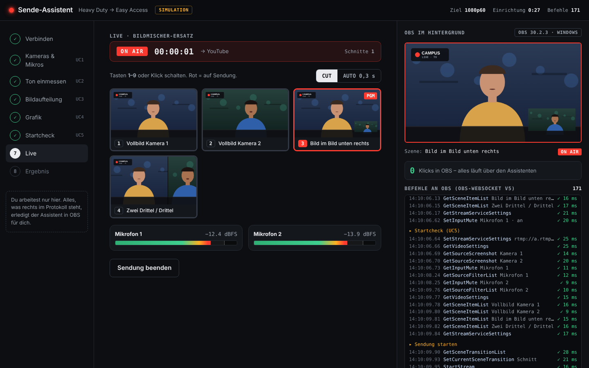

# Sende-Assistent

Web-App, die OBS Studio **im Hintergrund** über obs-websocket v5 einrichtet und danach als
Bildmischer-Ersatz dient. Die Person arbeitet nur im Assistenten, nie in OBS.
Projekt „Heavy Duty → Easy Access“: Ein Laptop mit OBS ersetzt Bildmischer und Grundfunktionen des Tonpults.

**Live:** https://liviuweb.github.io/

## Benutzen

**Demo (ohne OBS):** Seite öffnen → „Demo starten“. Ein simuliertes OBS beantwortet dieselben Befehle wie das echte Programm.

**Mit echtem OBS (ab Version 28):**
1. OBS öffnen → *Werkzeuge → WebSocket-Servereinstellungen* → „WebSocket-Server aktivieren“ → „Verbindungsinformationen anzeigen“ → Passwort kopieren.
2. Seite in Chrome, Edge oder Firefox öffnen, Passwort einfügen → „Verbinden“.
   Fragt der Browser nach Zugriff auf das lokale Netzwerk, erlauben.
3. Safari blockt die Verbindung von einer Webseite zum eigenen Rechner. Dann `index.html` herunterladen und lokal öffnen.

Die Seite verbindet sich nur mit dem OBS, dessen Adresse und Passwort eingetragen werden (Standard: `ws://localhost:4455`). Es werden keine Daten an einen Server geschickt.

## Ablauf (7 Schritte)

| Schritt | Person | Assistent in OBS |
|---|---|---|
| Verbinden | Qualität wählen (1080p60 Standard) | Auflösung und Bildrate setzen |
| UC1 Kameras & Mikros | Gerät aus Liste, Smartphone per QR-Code | Geräte suchen, Quellen anlegen, Smartphone über VDO.Ninja |
| UC2 Ton | 5 Sekunden sprechen | Pegel messen, Rauschunterdrückung → Kompressor → Verstärkung → Limiter, Kontrollmessung (Ziel −12 dBFS) |
| UC3 Bildaufteilung | Vorlagen anklicken, Kameras zuordnen | Eine Szene je Vorlage, Beschnitt statt Ränder |
| UC4 Grafik | Logo und Ecke wählen | Prüft in allen Szenen, ob das Logo ein Kamerabild verdeckt, schlägt freie Ecke vor |
| UC5 Startcheck | Stream-Key oder „nur aufnehmen“ | Auflösung, Bildrate, Bild, Ton, Grafik, Ziel als Ampel; Live-Knopf gesperrt bei Rot |
| Live | Tasten 1–9, CUT / AUTO | Szenen schalten, Stream oder Aufnahme starten und stoppen |

## Dateien

Alles liegt flach im Hauptordner.

| Datei | Inhalt |
|---|---|
| `index.html` | **fertige App** (eine Datei, wird von `build.js` erzeugt) |
| `core.js` | gesamte OBS-Logik, läuft mit echtem OBS und Simulation |
| `fake-obs.js` | Simulation: versteht rund 45 obs-websocket-Befehle, zeichnet Bild, erzeugt Pegel |
| `ui.js`, `index.template.html`, `style.css` | Oberfläche |
| `obs-ws.global.js` | Bibliothek [obs-websocket-js](https://github.com/obs-websocket-community-projects/obs-websocket-js) 5 (Browser-Build, MIT) |
| `build.js` | baut `index.html` aus den Einzeldateien |
| `test-demo.cjs` | Gesamtdurchlauf im Demo-Modus (Playwright) |
| `test-obs.cjs` | Gesamtdurchlauf gegen echtes OBS auf `localhost:4455` |
| `screenshot-*.png` | Bildschirmfotos |

Nach einer Änderung an den Einzeldateien: `node build.js` (kein `npm install` nötig).
Tests: `npm install`, dann `npm test` bzw. `npm run test:obs`.

## Getestet

OBS 30.0.2 mit obs-websocket 5.3.4 unter Ubuntu 24.04, ohne Kamera- und Tonhardware
(Kameras als Testbild-Quellen, Mikrofon als Audiodatei):

- Kompletter Durchlauf bis zur Aufnahme: 136 Befehle, 0 fehlgeschlagen, 0 Klicks in OBS
- Auto-Pegel: −35,1 dBFS → −11,3 dBFS (Ziel −12)
- Kollision: Logo verdeckte 35 % des kleinen Bildes → erkannt, verschoben, Nachprüfung ohne Befund
- Verbindung von einer https-Seite (`liviuweb.github.io`) zu OBS auf `localhost`: funktioniert in Chromium

### Beim Testen gefundene OBS-Eigenheiten (gelöst)

- Mikros müssen in jeder Sendeszene liegen, sonst sind sie inaktiv: nicht im Stream, keine Pegelanzeige.
- `RemoveInput` gibt den Namen verzögert frei → erst umbenennen, dann entfernen.
- Szenen und Quellen teilen sich die Namen → Szenen heißen „Vollbild Kamera 1“.
- Linux meldet die Distribution (z. B. „ubuntu“) statt „linux“ als Plattform.

## Bekannte Grenzen

- Ein Handgriff in OBS bleibt: den WebSocket-Server einmal einschalten.
- Logo im echten Modus: Der Browser kennt keine Dateipfade, der Pfad muss eingetippt werden.
- Smartphone über VDO.Ninja braucht die Browserquelle in OBS (unter Windows und macOS dabei).
- Die Kamerasuche ist mit echter Kamera noch nicht geprüft (Testumgebung ohne Videogeräte).
- Die Kollisionsprüfung rechnet mit dem Rahmen der Grafik, nicht mit ihren sichtbaren Pixeln.
